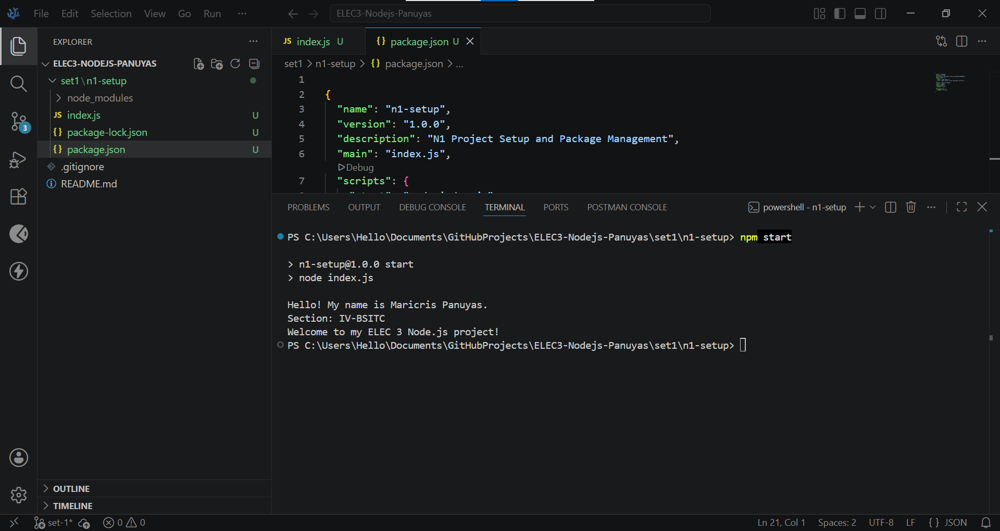
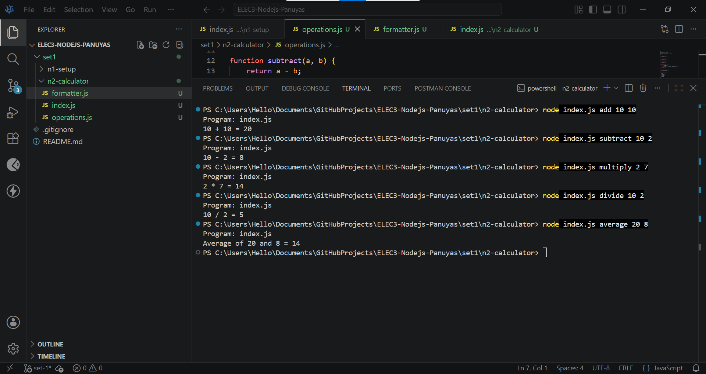
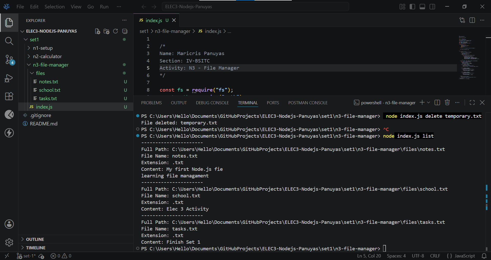

# ELEC 3 - Node.js Programming

**Name:** Maricris Panuyas  
**Section:** IV-BSITC  
**Course:** ELEC 3 – Node.js  
**Set:** 1

## Activities

### N1 – Project Setup and Package Management

Folder: [n1-setup](set1/n1-setup)

This activity demonstrates npm initialization, package management, and npm scripts.

**How to run:**

```powershell
cd set1/n1-setup
npm install
npm start
```

**Sample Output:**



### N2 – Modular Calculator

Folder: [n2-calculator](set1/n2-calculator)

This activity uses custom modules to perform five calculator operations.

**How to run:**

```powershell
cd set1/n2-calculator
node index.js add 12 8
node index.js subtract 20 7
node index.js multiply 2 7
node index.js divide 10 2
node index.js average 20 8
node index.js divide 10 0
node index.js power 10 2
```

**Sample Output:**



### N3 – File Manager

Folder: [n3-file-manager](set1/n3-file-manager)

This activity uses the built-in fs and path modules to create, read, update, delete, and list text files.

**How to run:**

```powershell
cd set1/n3-file-manager
node index.js create sample.txt "Hello"
node index.js read sample.txt
node index.js update sample.txt "New text"
node index.js list
node index.js delete sample.txt
node index.js read missing.txt
node index.js delete missing.txt
```

**Sample Output:**


```

